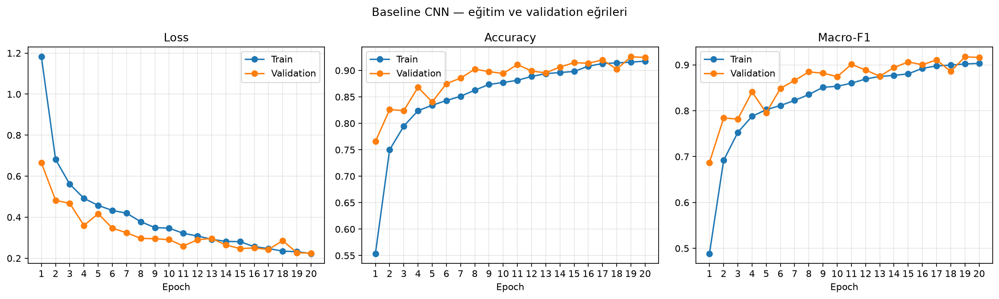
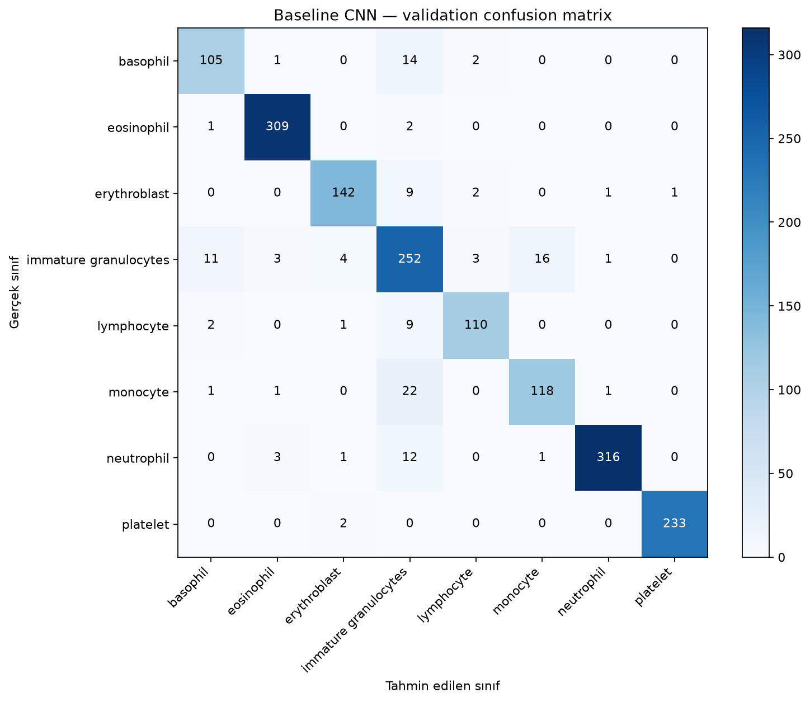

## Deney 1 — Baseline CNN

### Amaç

BloodMNIST üzerinde, simetri tabanlı veri artırma veya grup eşdeğişimli katman kullanmayan temel bir CNN eğitildi. Bu deney diğer yöntemlerle karşılaştırma için başlangıç noktasıdır.

### Veri ve protokol

MedMNIST’in resmi train, validation ve test bölünmeleri kullanıldı. Model eğitimi ve checkpoint seçimi sırasında test kümesi kullanılmadı.

| Bölünme | Görüntü sayısı |
|---|---:|
| Train | 11.959 |
| Validation | 1.712 |
| Test | 3.421 |

Görüntüler 3 kanallı ve 28×28 pikseldir. Etiketler sekiz kan hücresi sınıfından birini belirtir. Eğitim ve validation görüntülerine yalnızca `ToTensor()` uygulandı.

| Ayar | Değer |
|---|---|
| Random seed | 42 |
| Batch size | 32 |
| Epoch sayısı | 20 |
| Optimizer | AdamW |
| Learning rate | 0,001 |
| Weight decay | 0,0001 |
| Loss | CrossEntropyLoss |
| Model seçimi | Validation macro-F1 |
| Eğitilebilir parametre sayısı | 421.960 |

CNN iki convolution katmanı, ReLU aktivasyonları, max pooling katmanları ve tam bağlı bir sınıflandırıcıdan oluşur. Model sıfırdan eğitilmiştir.

### Validation sonuçları

En iyi checkpoint, **19. epoch’ta** validation macro-F1’e göre seçildi.

| Metrik | Sonuç |
|---|---:|
| Accuracy | 0,9258 |
| Macro-precision | 0,9231 |
| Macro-recall | 0,9129 |
| Macro-F1 | 0,9175 |
| Weighted F1 | 0,9266 |

### Sınıf bazında sonuçlar

| Sınıf | Precision | Recall | F1-score | Örnek |
|---|---:|---:|---:|---:|
| Basophil | 0,8750 | 0,8607 | 0,8678 | 122 |
| Eosinophil | 0,9748 | 0,9904 | 0,9825 | 312 |
| Erythroblast | 0,9467 | 0,9161 | 0,9311 | 155 |
| Immature granulocytes | 0,7875 | 0,8690 | 0,8262 | 290 |
| Lymphocyte | 0,9402 | 0,9016 | 0,9205 | 122 |
| Monocyte | 0,8741 | 0,8252 | 0,8489 | 143 |
| Neutrophil | 0,9906 | 0,9489 | 0,9693 | 333 |
| Platelet | 0,9957 | 0,9915 | 0,9936 | 235 |

### Gözlemler

Eğitim ilerledikçe train ve validation loss azaldı; accuracy ve macro-F1 yükseldi. Eğrilerde belirgin ve kalıcı bir train-validation ayrışması görülmedi. Bu koşuda 20 epoch sonunda açık bir overfitting işareti gözlenmedi.

En yüksek sınıf F1 değeri platelet ve eosinophil sınıflarında elde edildi. En düşük sınıf precision değeri immature granulocytes sınıfında görüldü. Confusion matrix’te öne çıkan karışmalar:

- 22 monocyte örneği immature granulocytes olarak tahmin edildi.
- 16 immature granulocytes örneği monocyte olarak tahmin edildi.
- 14 basophil örneği immature granulocytes olarak tahmin edildi.
- 12 neutrophil örneği immature granulocytes olarak tahmin edildi.

### Yorum ve sınırlılıklar

Baseline, validation kümesinde 0,9175 macro-F1 elde etti. Bu sonuç yalnızca validation performansıdır; nihai test performansı olarak yorumlanmamalıdır. Model seçimi için validation kümesi kullanıldı. Test kümesi, üç yaklaşım tamamlandıktan sonra yalnızca final değerlendirmede kullanılacaktır.

Eğitim süresi bu rapora eklenen konsol çıktısında yer almadığından raporlanmamıştır. Eğitim süresi karşılaştırma tablosuna ekleneceği zaman eğitim çıktısından ayrıca kaydedilmelidir.

### Grafikler

**Eğitim ve validation eğrileri**

**Validation confusion matrix**

