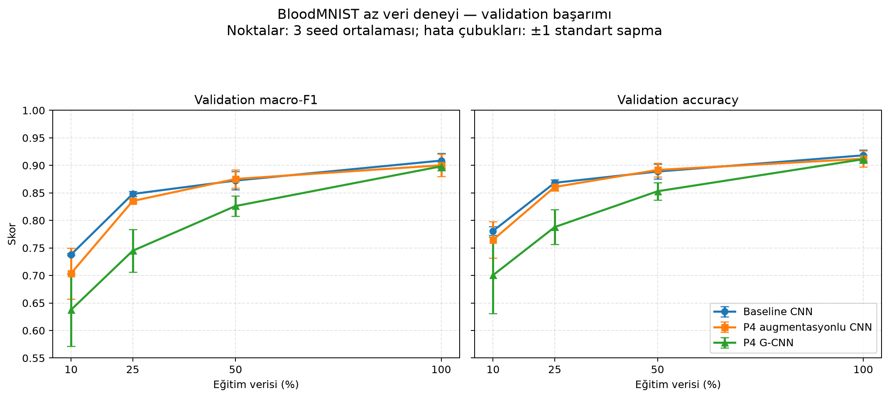

# BloodMNIST’te CNN, P4 Veri Artırma ve G-CNN Karşılaştırması

## Özet

Bu çalışmada BloodMNIST üzerinde üç görüntü sınıflandırma yaklaşımı karşılaştırıldı: sıfırdan eğitilen baseline CNN, aynı CNN’e eğitim sırasında P4 rotasyonları uygulayan model ve dört çeyrek dönüş üzerinde eşdeğişimli bir Group Equivariant CNN (G-CNN).

Karşılaştırmada validation macro-F1, accuracy, parametre sayısı ve eğitim süresi incelendi. Baseline CNN validation kümesinde en yüksek macro-F1 değerini aldı. P4 veri artırma sonucu baseline’a çok yakın kaldı. G-CNN daha az parametreye sahip olmasına rağmen bu eğitim ayarlarında daha düşük validation başarımı ve daha uzun eğitim süresi gösterdi. Validation’da seçilen baseline model daha sonra test kümesinde bir kez değerlendirildi.

## Problem ve araştırma sorusu

Mikroskop görüntülerindeki kan hücresi sınıflandırmasında görüntünün yönü değişebilir. Modelin bu değişikliklere karşı tutarlı tahminler üretmesi için eğitim görüntüleri döndürülebilir veya dönüş simetrisi doğrudan model mimarisine katılabilir.

Bu çalışmanın araştırma sorusu şudur:

> P4 rotasyon veri artırma ve P4 eşdeğişimli G-CNN, standart CNN’e kıyasla BloodMNIST sınıflandırma başarımını, parametre sayısını ve eğitim maliyetini nasıl etkiler?

G-CNN’in veya veri artırmanın daha iyi sonuç vereceği varsayılmadı. Sonuçlar deneylerden elde edildi.

## Veri kümesi

BloodMNIST, 28×28 boyutunda, üç kanallı RGB kan hücresi görüntülerinden oluşur. MedMNIST’in resmi train, validation ve test bölünmeleri kullanıldı. MedMNIST benchmark’ı ve kaynak kan hücresi görüntüleri ilgili yayınlara dayandırılmıştır [2, 3].

| Bölünme | Görüntü sayısı |
|---|---:|
| Train | 11.959 |
| Validation | 1.712 |
| Test | 3.421 |
| Toplam | 17.092 |

Sınıflar basophil, eosinophil, erythroblast, immature granulocytes, lymphocyte, monocyte, neutrophil ve platelet’tir. Sınıf dağılımı eşit değildir. Bu nedenle accuracy’ye ek olarak her sınıfı eşit ağırlıklandıran macro-F1 raporlandı.

Test kümesi eğitim ve model seçimi sırasında kullanılmadı. Yalnızca validation sonuçlarıyla baseline CNN seçildikten sonra final değerlendirmede kullanıldı.

## Yöntemler

### 1. Baseline CNN

Baseline model sıfırdan eğitilmiş standart bir CNN’dir. Mimari iki convolution katmanı, ReLU aktivasyonları, iki max-pooling işlemi ve tam bağlı sınıflandırıcıdan oluşur:

- Conv2d: 3 → 32 kanal
- ReLU ve 2×2 max pooling
- Conv2d: 32 → 64 kanal
- ReLU ve 2×2 max pooling
- Flatten, 128 birimli tam bağlı katman, ReLU ve dropout
- 8 sınıf için logits üreten çıkış katmanı

Modelde 421.960 eğitilebilir parametre vardır.

### 2. P4 rotasyon veri artırmalı CNN

Bu deneyde baseline CNN’in mimarisi ve eğitim ayarları korundu. Yalnızca eğitim görüntülerine rastgele 0°, 90°, 180° veya 270° dönüş uygulandı. Validation ve test görüntülerine rastgele eğitim augmentasyonu uygulanmadı.

Dönüşler `torch.rot90` ile yapıldı; pikseller ara açılarda yeniden örneklenmedi. Bu deney, dönüşlere karşı veri temelli dayanıklılık öğretir. Dönüşleri model mimarisine dahil eden G-CNN ile aynı yöntem değildir.

### 3. P4 G-CNN

G-CNN’in ilk katmanı RGB görüntülerden dört yönelimli özellik haritası üretir. Sonraki group convolution katmanları uzamsal boyutların yanında yönelim boyutunu da taşır. Sınıflandırıcı, yönelim ve uzamsal boyutlarda ortalama alarak dönüş altında değişmeyen logits üretir. Bu yaklaşım, grup simetrilerini evrişimlere dahil eden Cohen ve Welling’in G-CNN çalışmasından esinlenir [1].

Bu uygulamada “P4” adı dört elemanlı 90° dönüş grubunu ifade eder: 0°, 90°, 180° ve 270°. Uygulama yansıma veya keyfi açılarda dönüş eşdeğişimliliği iddia etmez.

G-CNN’de 56.072 eğitilebilir parametre vardır. P4 dönüş eylemi, özellik haritasının uzamsal eksenlerini `k × 90°` döndürür ve yönelim eksenini aynı miktarda dairesel kaydırır. Eşdeğişimlilik testleri her `k ∈ {1, 2, 3}` için `F(R_k x) = T_k F(x)` ilişkisini karşılaştırır; burada `R_k` görüntü dönüşü, `T_k` grup özelliklerine uygulanan uzamsal dönüş ve yönelim kaydırmasıdır. Sınıflandırıcı için kontrol edilen ilişki `C(R_k x) = C(x)` şeklindeki değişmezliktir.

Test paketi beş kontrol içerir ve tamamı başarılıdır:

- P4 özellik dönüşümünün grup birleşim kuralı: `T_a(T_b(f)) = T_(a+b mod 4)(f)`.
- Görüntüden grup özelliklerine geçiş katmanının eşdeğişimliliği.
- Group convolution katmanının eşdeğişimliliği.
- Uzamsal max-pooling katmanının eşdeğişimliliği.
- Tam G-CNN’in sınıflandırma logits’lerinin 90° dönüşlerde değişmezliği.

Katman testleri gerçek tensör çıktılarını beklenen dönüşmüş tensörlerle sayısal tolerans içinde karşılaştırır. Bunlar sonlu sayıda girdi üzerinde uygulama testidir; tek başlarına tüm olası girdiler için biçimsel matematiksel ispat değildir. Eşdeğişimlilik iddiası bu testlerle birlikte P4 katmanlarının paylaşılan ağırlık ve dönüşüm yapısına dayanır; kapsam dört çeyrek dönüşle sınırlıdır.

## Deney protokolü

Üç yöntemde ortak ayarlar kullanıldı:

| Ayar | Değer |
|---|---|
| Random seed | 42 |
| Batch size | 32 |
| Epoch | 20 |
| Optimizer | AdamW |
| Learning rate | 0,001 |
| Weight decay | 0,0001 |
| Loss | CrossEntropyLoss |
| Checkpoint seçimi | Validation macro-F1 |

Ortam: Python 3.12.8, PyTorch 2.11.0+cu128, CUDA 12.8 ve NVIDIA GeForce RTX 4060 Laptop GPU.

Eğitim süreleri `epoch_seconds` değerlerinin toplamıdır. Bunlar epoch sürelerini karşılaştırır; Python başlatma ve tüm süreç kapanış maliyetlerini kapsayan tam duvar saati süresi değildir.

## Validation sonuçları

P4 veri artırma ve G-CNN metrikleri paylaşılan validation confusion matrix’lerinden hesaplanıp dört ondalık basamağa yuvarlandı. Baseline metrikleri sınıf raporundan alındı.

| Model | Accuracy | Macro-precision | Macro-recall | Macro-F1 | Parametre | Epoch süreleri toplamı |
|---|---:|---:|---:|---:|---:|---:|
| Baseline CNN | 0,9258 | 0,9231 | 0,9129 | 0,9175 | 421.960 | 55,66 sn |
| P4 augmentasyonlu CNN | 0,9252 | 0,9259 | 0,9107 | 0,9174 | 421.960 | 62,94 sn |
| P4 G-CNN | 0,8931 | 0,8854 | 0,8692 | 0,8761 | 56.072 | 105,67 sn |

### Baseline CNN

Baseline, validation macro-F1’de 0,9175 elde etti. En yüksek sınıf F1 değerleri eosinophil (0,9825) ve platelet (0,9936) sınıflarında görüldü. Immature granulocytes precision değeri 0,7875 ile en düşük sınıf precision’ı oldu.


### P4 augmentasyonlu CNN

Validation accuracy yaklaşık 0,9252, macro-F1 yaklaşık 0,9174 oldu. Baseline’a göre genel fark çok küçüktür; bu tek koşu augmentasyonun genel validation performansını artırdığını göstermedi. Sınıf düzeyinde bazı değişimler oldu, ancak tüm sınıflar aynı yönde etkilenmedi.


### P4 G-CNN

G-CNN validation accuracy’de yaklaşık 0,8931 ve macro-F1’de yaklaşık 0,8761 elde etti. Baseline’dan daha az parametreye sahip olmasına rağmen epoch süreleri toplamı baseline’ın yaklaşık 1,9 katı oldu.

G-CNN’in train ve validation eğrileri birbirine yakın seyretti; loss düşerken metrikler yükselmeye devam etti. Bu koşuda belirgin bir train-validation ayrışması görülmedi. Train başarımının da düşük kalması, bu model ve 20 epoch’luk eğitim ayarlarında yetersiz öğrenme olasılığıyla uyumludur. G-CNN’in düşük başarımının tek bir nedeni bu deneyle kanıtlanamaz.


## Rotasyon tutarlılığı deneyi

Üç eğitilmiş model, aynı 1.712 validation görüntüsünün 0°, 90°, 180° ve 270° döndürülmüş hâllerinde değerlendirildi. Bu aşamada yeniden eğitim yapılmadı ve test kümesi kullanılmadı. Her açı için accuracy ve macro-F1 ölçüldü. Ayrıca döndürülmüş görüntü tahminlerinin aynı görüntünün 0° tahminiyle ne oranda eşleştiği hesaplandı.

| Model | Dönüş | Accuracy | Macro-F1 | 0° tahminiyle uyum |
|---|---:|---:|---:|---:|
| Baseline CNN | 0° | 0,9258 | 0,9175 | 1,0000 |
| Baseline CNN | 90° | 0,8966 | 0,8841 | 0,9200 |
| Baseline CNN | 180° | 0,9048 | 0,8917 | 0,9282 |
| Baseline CNN | 270° | 0,9100 | 0,9012 | 0,9217 |
| P4 augmentasyonlu CNN | 0° | 0,9252 | 0,9174 | 1,0000 |
| P4 augmentasyonlu CNN | 90° | 0,9264 | 0,9195 | 0,9591 |
| P4 augmentasyonlu CNN | 180° | 0,9287 | 0,9216 | 0,9544 |
| P4 augmentasyonlu CNN | 270° | 0,9282 | 0,9202 | 0,9632 |
| P4 G-CNN | 0° | 0,8931 | 0,8761 | 1,0000 |
| P4 G-CNN | 90° | 0,8931 | 0,8761 | 1,0000 |
| P4 G-CNN | 180° | 0,8931 | 0,8761 | 1,0000 |
| P4 G-CNN | 270° | 0,8931 | 0,8761 | 1,0000 |

Tüm dört açıda tahmini aynı kalan görüntü oranı baseline CNN için 0,8557, P4 augmentasyonlu CNN için 0,9282 ve P4 G-CNN için 1,0000 oldu. G-CNN’in logits değişmezliği tasarımıyla uyumlu biçimde tahmini her dönüşte aynı kaldı. P4 augmentasyonu da baseline’a kıyasla tahmin tutarlılığını artırdı; bu deneyde döndürülmüş görüntülerde sınıflandırma başarımı en yüksek P4 augmentasyonlu CNN’deydi.

Tutarlılık ve doğruluk farklı ölçümlerdir: bir model her dönüşte aynı tahmini verebilir, ancak bu tahmin yanlış olabilir. Bu nedenle G-CNN’in %100 tahmin uyumu tek başına en iyi sınıflandırıcı olduğu anlamına gelmez. Rotasyon tutarlılığı çıktısı `outputs/logs/rotation_consistency.csv` dosyasındadır.

## Az veri deneyi

Az veri koşullarındaki davranışı incelemek için train kümesinin sınıf oranlarını koruyan %10, %25, %50 ve %100 alt kümeleri kullanıldı. Her oran ve model üç seed (42, 43, 44) ile çalıştırıldı; böylece toplam 36 eğitim koşusu yapıldı. Aynı seed ve veri oranında üç model aynı train örneklerini kullandı. P4 augmentasyonu yalnızca eğitim görüntülerine uygulandı. Her koşuda model seçimi tam validation kümesindeki macro-F1’e göre yapıldı; test kümesi kullanılmadı.

Aşağıdaki değerler üç seed ortalaması ± örnek standart sapmasıdır. Accuracy ve macro-F1, seçilen checkpoint’in tam validation kümesindeki sonuçlarıdır.

| Model | Train oranı | Train örneği | Accuracy ort. ± std | Macro-F1 ort. ± std |
|---|---:|---:|---:|---:|
| Baseline CNN | %10 | yaklaşık 1.196 | 0,7810 ± 0,0076 | 0,7379 ± 0,0017 |
| P4 augmentasyonlu CNN | %10 | yaklaşık 1.196 | 0,7648 ± 0,0332 | 0,7038 ± 0,0463 |
| P4 G-CNN | %10 | yaklaşık 1.196 | 0,7005 ± 0,0693 | 0,6376 ± 0,0658 |
| Baseline CNN | %25 | yaklaşık 2.990 | 0,8684 ± 0,0059 | 0,8481 ± 0,0046 |
| P4 augmentasyonlu CNN | %25 | yaklaşık 2.990 | 0,8608 ± 0,0074 | 0,8353 ± 0,0027 |
| P4 G-CNN | %25 | yaklaşık 2.990 | 0,7880 ± 0,0316 | 0,7449 ± 0,0389 |
| Baseline CNN | %50 | yaklaşık 5.980 | 0,8888 ± 0,0135 | 0,8724 ± 0,0164 |
| P4 augmentasyonlu CNN | %50 | yaklaşık 5.980 | 0,8917 ± 0,0124 | 0,8753 ± 0,0165 |
| P4 G-CNN | %50 | yaklaşık 5.980 | 0,8530 ± 0,0159 | 0,8262 ± 0,0187 |
| Baseline CNN | %100 | 11.959 | 0,9182 ± 0,0102 | 0,9087 ± 0,0137 |
| P4 augmentasyonlu CNN | %100 | 11.959 | 0,9120 ± 0,0148 | 0,9002 ± 0,0206 |
| P4 G-CNN | %100 | 11.959 | 0,9112 ± 0,0073 | 0,8983 ± 0,0081 |

Bu koşulda veri oranı arttıkça her üç modelin ortalama macro-F1 değeri yükseldi. Baseline CNN %10, %25 ve %100 oranlarında en yüksek ortalama macro-F1’i aldı. %50 oranında P4 augmentasyonlu CNN’in ortalaması baseline’dan 0,0029 daha yüksekti; üç tekrarlı sonuçlar bu küçük farkı kesin üstünlük olarak yorumlamak için yeterli değildir. G-CNN ortalaması her oranda daha düşük kaldı; özellikle %10 oranında seed’ler arasındaki değişkenliği yüksekti. %100 oranında G-CNN’in ortalaması diğer iki modele yaklaştı.

Bu sonuçlar üç seed ile yapılan sınırlı bir tekrarlı deneydir. Standart sapmalar seed’ler arasındaki değişimi gösterir; daha fazla tekrar model farklarının belirsizliğini daha iyi ölçebilir. Koşu başına ayrıntılar ve süreler `outputs/logs/low_data/low_data_results.csv` dosyasında, epoch geçmişleri aynı klasörde saklanır.



## Final test değerlendirmesi

Model validation macro-F1’e göre seçildi. Baseline 0,9175 ile en yüksek değeri aldığı için final test değerlendirmesinde yalnızca baseline checkpoint’i kullanıldı. Test kümesi hiperparametre seçimi veya model karşılaştırması için kullanılmadı.

| Metrik | Test sonucu |
|---|---:|
| Accuracy | 0,9164 |
| Macro-precision | 0,9199 |
| Macro-recall | 0,8999 |
| Macro-F1 | 0,9084 |

Confusion matrix’te 3.421 test örneğinin 3.135’i doğru sınıflandırıldı. En belirgin karışmalar monocyte örneklerinin immature granulocytes olarak (53 örnek) ve neutrophil örneklerinin immature granulocytes olarak (35 örnek) sınıflandırılmasıydı.

| Sınıf | Precision | Recall | F1-score | Örnek |
|---|---:|---:|---:|---:|
| Basophil | 0,8607 | 0,8607 | 0,8607 | 244 |
| Eosinophil | 0,9642 | 0,9920 | 0,9779 | 624 |
| Erythroblast | 0,9683 | 0,8842 | 0,9244 | 311 |
| Immature granulocytes | 0,7563 | 0,8791 | 0,8131 | 579 |
| Lymphocyte | 0,9509 | 0,8765 | 0,9122 | 243 |
| Monocyte | 0,8845 | 0,7817 | 0,8299 | 284 |
| Neutrophil | 0,9763 | 0,9294 | 0,9523 | 666 |
| Platelet | 0,9979 | 0,9957 | 0,9968 | 470 |

Validation macro-F1 ile test macro-F1 arasındaki fark yaklaşık 0,91 yüzde puandır. Test sonucu validation başarımından biraz düşüktür; bu değerlendirmede büyük bir performans çöküşü görülmedi.


## Sonuç ve tartışma

Bu deney koşusunda baseline CNN en yüksek validation macro-F1’i elde etti ve test kümesinde 0,9084 macro-F1’e ulaştı. P4 rotasyon veri artırmalı CNN’in genel validation başarımı baseline’a çok yakın kaldı. P4 G-CNN daha az parametreye sahipti fakat daha uzun eğitim süresine ve daha düşük validation başarımına sahipti.

Bu sonuçlar, G-CNN’in genel olarak daha kötü olduğunu veya rotasyon artırmanın hiçbir durumda yarar sağlamadığını kanıtlamaz. Her yaklaşım yalnızca bir seed ile çalıştırıldı; bu nedenle küçük farkların rastgelelikten kaynaklanma olasılığı ölçülmedi. Daha güvenilir yöntem karşılaştırması için sonraki çalışmada birden fazla seed ile tekrarlı deneyler yapılabilir.

Başlıca sınırlılıklar:

- İlk tam veri karşılaştırması tek seed ile yapıldı. Az veri deneyi üç seed içeriyor; bu tekrar sayısı hâlâ sınırlıdır.
- Görüntüler 28×28 çözünürlükte ve MedMNIST’in ön işlenmiş sürümüdür.
- P4 dönüş varsayımı yalnızca dört çeyrek dönüşü kapsar.
- Farklı model genişliği, eğitim süresi veya hiperparametreler bu kontrollü karşılaştırmada denenmedi.
- Test kümesi bir kez final değerlendirmede kullanıldı; test sonuçlarına göre ayar yapılmadı.

## Kaynakça

1. Taco Cohen ve Max Welling. “Group Equivariant Convolutional Networks.” *Proceedings of the 33rd International Conference on Machine Learning*, Proceedings of Machine Learning Research, cilt 48, s. 2990–2999, 2016. [Makale sayfası](https://proceedings.mlr.press/v48/cohenc16.html).
2. Jiancheng Yang ve diğerleri. “MedMNIST v2: A large-scale lightweight benchmark for 2D and 3D biomedical image classification.” *Scientific Data*, cilt 10, makale 41, 2023. [DOI: 10.1038/s41597-022-01721-8](https://doi.org/10.1038/s41597-022-01721-8).
3. A. Acevedo ve diğerleri. “A dataset of microscopic peripheral blood cell images for development of automatic recognition systems.” *Data in Brief*, cilt 30, makale 105474, 2020. [DOI: 10.1016/j.dib.2020.105474](https://doi.org/10.1016/j.dib.2020.105474).

## Çalıştırma komutları

Komutları proje kök klasöründeki PowerShell’den çalıştırın. Veri kümesi ilk inceleme sırasında `data/` altına indirilir.

```powershell
python scripts\data\inspect_dataset.py

python scripts\training\train_baseline.py
python scripts\plotting\plot_training.py
python scripts\evaluation\evaluate_baseline.py

python scripts\training\train_augmented.py
python scripts\plotting\plot_augmented.py
python scripts\evaluation\evaluate_augmented.py

python -m unittest discover -s tests -p "test_gcnn.py" -v
python scripts\training\train_gcnn.py
python scripts\plotting\plot_gcnn.py
python scripts\evaluation\evaluate_gcnn.py

python scripts\evaluation\evaluate_rotation_consistency.py
python scripts\experiments\run_low_data_experiment.py
python scripts\plotting\plot_low_data.py
python scripts\evaluation\evaluate_final.py
```

Eğitim geçmişleri `outputs/logs/`, checkpoint’ler `outputs/checkpoints/`, grafikler `outputs/plots/` altında saklanır. Deney karşılaştırma tablosu `experiments/results.csv` dosyasındadır.
