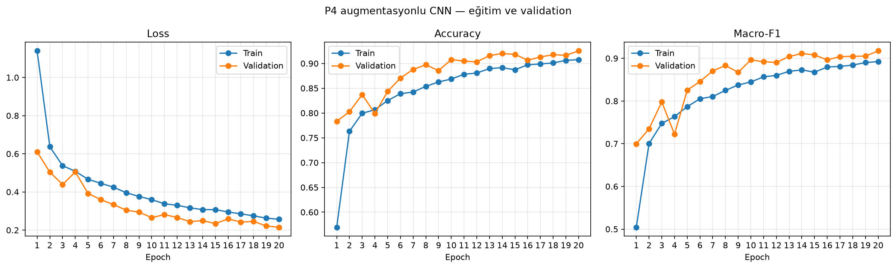
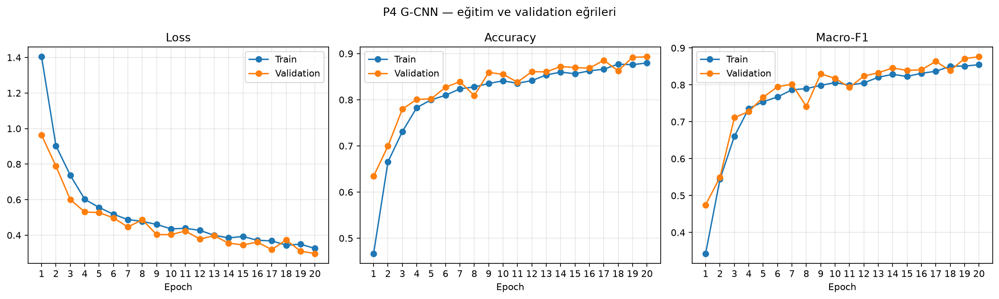
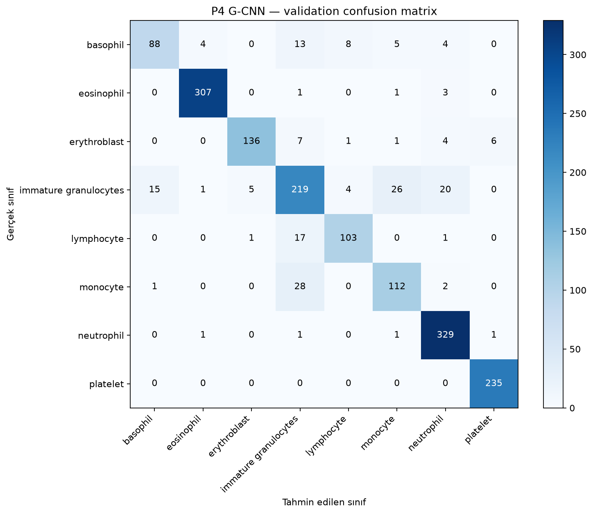
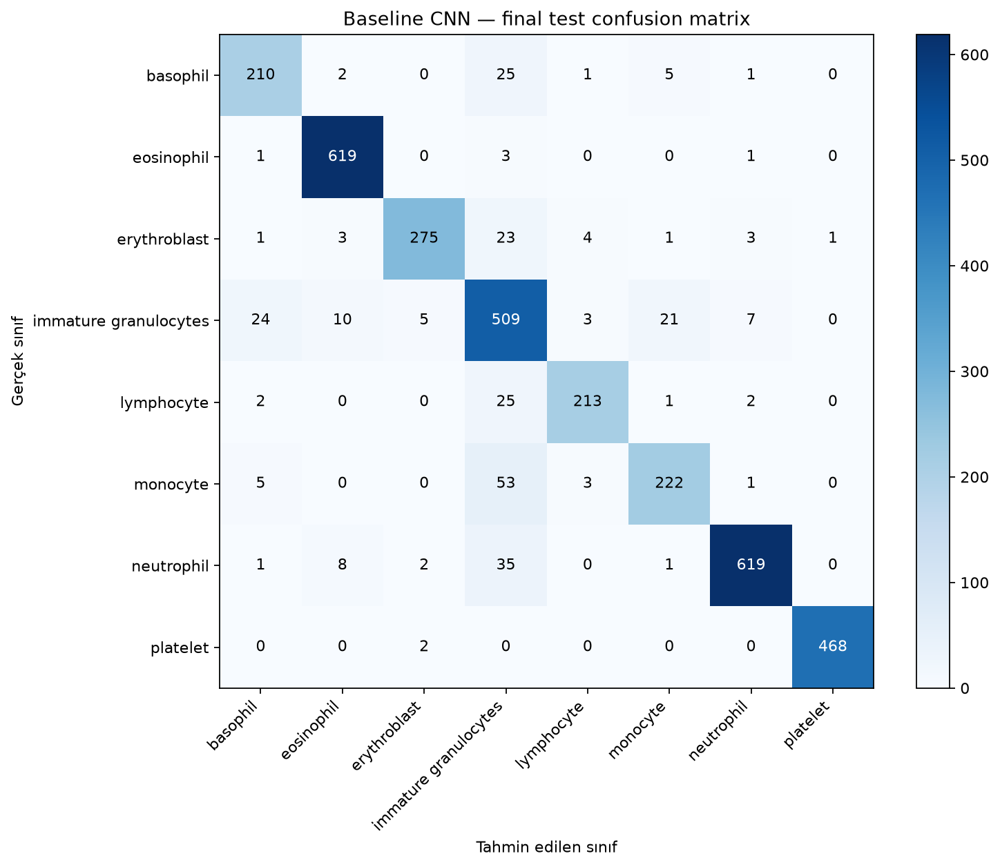

# BloodMNIST’te CNN, P4 Veri Artırma ve G-CNN Karşılaştırması

## Özet

Bu çalışmada BloodMNIST üzerinde üç görüntü sınıflandırma yaklaşımı karşılaştırıldı: sıfırdan eğitilen baseline CNN, aynı CNN’e eğitim sırasında P4 rotasyonları uygulayan model ve dört çeyrek dönüş üzerinde eşdeğişimli bir Group Equivariant CNN (G-CNN).

Karşılaştırmada validation macro-F1, accuracy, parametre sayısı ve eğitim süresi incelendi. Baseline CNN validation kümesinde en yüksek macro-F1 değerini aldı. P4 veri artırma sonucu baseline’a çok yakın kaldı. G-CNN daha az parametreye sahip olmasına rağmen bu eğitim ayarlarında daha düşük validation başarımı ve daha uzun eğitim süresi gösterdi. Validation’da seçilen baseline model daha sonra test kümesinde bir kez değerlendirildi.

## Problem ve araştırma sorusu

Mikroskop görüntülerindeki kan hücresi sınıflandırmasında görüntünün yönü değişebilir. Modelin bu değişikliklere karşı tutarlı tahminler üretmesi için eğitim görüntüleri döndürülebilir veya dönüş simetrisi doğrudan model mimarisine katılabilir.

Bu çalışmanın araştırma sorusu şudur:

> P4 rotasyon veri artırma ve P4 eşdeğişimli G-CNN, standart CNN’e kıyasla BloodMNIST sınıflandırma başarımını, parametre sayısını ve eğitim maliyetini nasıl etkiler?

G-CNN’in veya veri artırmanın daha iyi sonuç vereceği varsayılmadı. Sonuçlar deneylerden elde edildi.

## Veri kümesi

BloodMNIST, 28×28 boyutunda, üç kanallı RGB kan hücresi görüntülerinden oluşur. MedMNIST’in resmi train, validation ve test bölünmeleri kullanıldı.

| Bölünme | Görüntü sayısı |
|---|---:|
| Train | 11.959 |
| Validation | 1.712 |
| Test | 3.421 |
| Toplam | 17.092 |

Sınıflar basophil, eosinophil, erythroblast, immature granulocytes, lymphocyte, monocyte, neutrophil ve platelet’tir. Sınıf dağılımı eşit değildir. Bu nedenle accuracy’ye ek olarak her sınıfı eşit ağırlıklandıran macro-F1 raporlandı.

Test kümesi eğitim ve model seçimi sırasında kullanılmadı. Yalnızca validation sonuçlarıyla baseline CNN seçildikten sonra final değerlendirmede kullanıldı.

## Yöntemler

### 1. Baseline CNN

Baseline model sıfırdan eğitilmiş standart bir CNN’dir. Mimari iki convolution katmanı, ReLU aktivasyonları, iki max-pooling işlemi ve tam bağlı sınıflandırıcıdan oluşur:

- Conv2d: 3 → 32 kanal
- ReLU ve 2×2 max pooling
- Conv2d: 32 → 64 kanal
- ReLU ve 2×2 max pooling
- Flatten, 128 birimli tam bağlı katman, ReLU ve dropout
- 8 sınıf için logits üreten çıkış katmanı

Modelde 421.960 eğitilebilir parametre vardır.

### 2. P4 rotasyon veri artırmalı CNN

Bu deneyde baseline CNN’in mimarisi ve eğitim ayarları korundu. Yalnızca eğitim görüntülerine rastgele 0°, 90°, 180° veya 270° dönüş uygulandı. Validation ve test görüntülerine rastgele eğitim augmentasyonu uygulanmadı.

Dönüşler `torch.rot90` ile yapıldı; pikseller ara açılarda yeniden örneklenmedi. Bu deney, dönüşlere karşı veri temelli dayanıklılık öğretir. Dönüşleri model mimarisine dahil eden G-CNN ile aynı yöntem değildir.

### 3. P4 G-CNN

G-CNN’in ilk katmanı RGB görüntülerden dört yönelimli özellik haritası üretir. Sonraki group convolution katmanları uzamsal boyutların yanında yönelim boyutunu da taşır. Sınıflandırıcı, yönelim ve uzamsal boyutlarda ortalama alarak dönüş altında değişmeyen logits üretir.

Bu uygulamada “P4” adı dört elemanlı 90° dönüş grubunu ifade eder: 0°, 90°, 180° ve 270°. Uygulama yansıma veya keyfi açılarda dönüş eşdeğişimliliği iddia etmez.

G-CNN’de 56.072 eğitilebilir parametre vardır. Group convolution ve sınıflandırıcı için üç eşdeğişimlilik testi yazıldı; üçü de başarılı oldu:

- Görüntüden grup özelliklerine geçiş testi
- Group convolution eşdeğişimlilik testi
- Dönmüş girdilerde sınıflandırma logits’lerinin değişmezliği testi

## Deney protokolü

Üç yöntemde ortak ayarlar kullanıldı:

| Ayar | Değer |
|---|---|
| Random seed | 42 |
| Batch size | 32 |
| Epoch | 20 |
| Optimizer | AdamW |
| Learning rate | 0,001 |
| Weight decay | 0,0001 |
| Loss | CrossEntropyLoss |
| Checkpoint seçimi | Validation macro-F1 |

Ortam: Python 3.12.8, PyTorch 2.11.0+cu128, CUDA 12.8 ve NVIDIA GeForce RTX 4060 Laptop GPU.

Eğitim süreleri `epoch_seconds` değerlerinin toplamıdır. Bunlar epoch sürelerini karşılaştırır; Python başlatma ve tüm süreç kapanış maliyetlerini kapsayan tam duvar saati süresi değildir.

## Validation sonuçları

P4 veri artırma ve G-CNN metrikleri paylaşılan validation confusion matrix’lerinden hesaplanıp dört ondalık basamağa yuvarlandı. Baseline metrikleri sınıf raporundan alındı.

| Model | Accuracy | Macro-precision | Macro-recall | Macro-F1 | Parametre | Epoch süreleri toplamı |
|---|---:|---:|---:|---:|---:|---:|
| Baseline CNN | 0,9258 | 0,9231 | 0,9129 | 0,9175 | 421.960 | 55,66 sn |
| P4 augmentasyonlu CNN | 0,9252 | 0,9259 | 0,9107 | 0,9174 | 421.960 | 62,94 sn |
| P4 G-CNN | 0,8931 | 0,8854 | 0,8692 | 0,8761 | 56.072 | 105,67 sn |

### Baseline CNN

Baseline, validation macro-F1’de 0,9175 elde etti. En yüksek sınıf F1 değerleri eosinophil (0,9825) ve platelet (0,9936) sınıflarında görüldü. Immature granulocytes precision değeri 0,7875 ile en düşük sınıf precision’ı oldu.


### P4 augmentasyonlu CNN

Validation accuracy yaklaşık 0,9252, macro-F1 yaklaşık 0,9174 oldu. Baseline’a göre genel fark çok küçüktür; bu tek koşu augmentasyonun genel validation performansını artırdığını göstermedi. Sınıf düzeyinde bazı değişimler oldu, ancak tüm sınıflar aynı yönde etkilenmedi.




### P4 G-CNN

G-CNN validation accuracy’de yaklaşık 0,8931 ve macro-F1’de yaklaşık 0,8761 elde etti. Baseline’dan daha az parametreye sahip olmasına rağmen epoch süreleri toplamı baseline’ın yaklaşık 1,9 katı oldu.

G-CNN’in train ve validation eğrileri birbirine yakın seyretti; loss düşerken metrikler yükselmeye devam etti. Bu koşuda belirgin bir train-validation ayrışması görülmedi. Train başarımının da düşük kalması, bu model ve 20 epoch’luk eğitim ayarlarında yetersiz öğrenme olasılığıyla uyumludur. G-CNN’in düşük başarımının tek bir nedeni bu deneyle kanıtlanamaz.





## Final test değerlendirmesi

Model validation macro-F1’e göre seçildi. Baseline 0,9175 ile en yüksek değeri aldığı için final test değerlendirmesinde yalnızca baseline checkpoint’i kullanıldı. Test kümesi hiperparametre seçimi veya model karşılaştırması için kullanılmadı.

| Metrik | Test sonucu |
|---|---:|
| Accuracy | 0,9164 |
| Macro-precision | 0,9199 |
| Macro-recall | 0,8999 |
| Macro-F1 | 0,9084 |

Confusion matrix’te 3.421 test örneğinin 3.135’i doğru sınıflandırıldı. En belirgin karışmalar monocyte örneklerinin immature granulocytes olarak (53 örnek) ve neutrophil örneklerinin immature granulocytes olarak (35 örnek) sınıflandırılmasıydı.

| Sınıf | Precision | Recall | F1-score | Örnek |
|---|---:|---:|---:|---:|
| Basophil | 0,8607 | 0,8607 | 0,8607 | 244 |
| Eosinophil | 0,9642 | 0,9920 | 0,9779 | 624 |
| Erythroblast | 0,9683 | 0,8842 | 0,9244 | 311 |
| Immature granulocytes | 0,7563 | 0,8791 | 0,8131 | 579 |
| Lymphocyte | 0,9509 | 0,8765 | 0,9122 | 243 |
| Monocyte | 0,8845 | 0,7817 | 0,8299 | 284 |
| Neutrophil | 0,9763 | 0,9294 | 0,9523 | 666 |
| Platelet | 0,9979 | 0,9957 | 0,9968 | 470 |

Validation macro-F1 ile test macro-F1 arasındaki fark yaklaşık 0,91 yüzde puandır. Test sonucu validation başarımından biraz düşüktür; bu değerlendirmede büyük bir performans çöküşü görülmedi.



## Sonuç ve tartışma

Bu deney koşusunda baseline CNN en yüksek validation macro-F1’i elde etti ve test kümesinde 0,9084 macro-F1’e ulaştı. P4 rotasyon veri artırmalı CNN’in genel validation başarımı baseline’a çok yakın kaldı. P4 G-CNN daha az parametreye sahipti fakat daha uzun eğitim süresine ve daha düşük validation başarımına sahipti.

Bu sonuçlar, G-CNN’in genel olarak daha kötü olduğunu veya rotasyon artırmanın hiçbir durumda yarar sağlamadığını kanıtlamaz. Her yaklaşım yalnızca bir seed ile çalıştırıldı; bu nedenle küçük farkların rastgelelikten kaynaklanma olasılığı ölçülmedi. Daha güvenilir yöntem karşılaştırması için sonraki çalışmada birden fazla seed ile tekrarlı deneyler yapılabilir.

Başlıca sınırlılıklar:

- Sonuçlar tek seed ve tek eğitim koşusuna dayanıyor.
- Görüntüler 28×28 çözünürlükte ve MedMNIST’in ön işlenmiş sürümüdür.
- P4 dönüş varsayımı yalnızca dört çeyrek dönüşü kapsar.
- Farklı model genişliği, eğitim süresi veya hiperparametreler bu kontrollü karşılaştırmada denenmedi.
- Test kümesi bir kez final değerlendirmede kullanıldı; test sonuçlarına göre ayar yapılmadı.

## Çalıştırma komutları

Komutları proje kök klasöründeki PowerShell’den çalıştırın. Veri kümesi ilk inceleme sırasında `data/` altına indirilir.

```powershell
python scripts\inspect_dataset.py

python scripts\train_baseline.py
python scripts\plot_training.py
python scripts\evaluate_baseline.py

python scripts\train_augmented.py
python scripts\plot_augmented.py
python scripts\evaluate_augmented.py

python -m unittest discover -s tests -p "test_gcnn.py" -v
python scripts\train_gcnn.py
python scripts\plot_gcnn.py
python scripts\evaluate_gcnn.py

python scripts\evaluate_final.py
```

Eğitim geçmişleri `outputs/logs/`, checkpoint’ler `outputs/checkpoints/`, grafikler `outputs/plots/` altında saklanır. Deney karşılaştırma tablosu `experiments/results.csv` dosyasındadır.